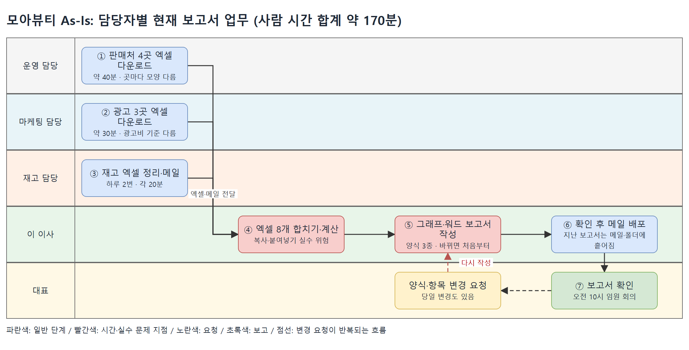
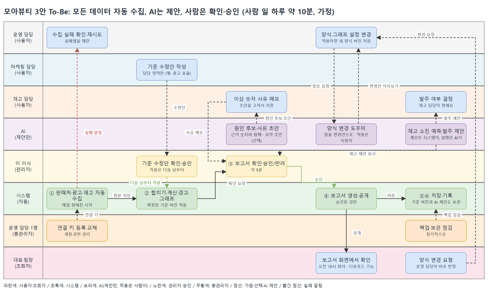
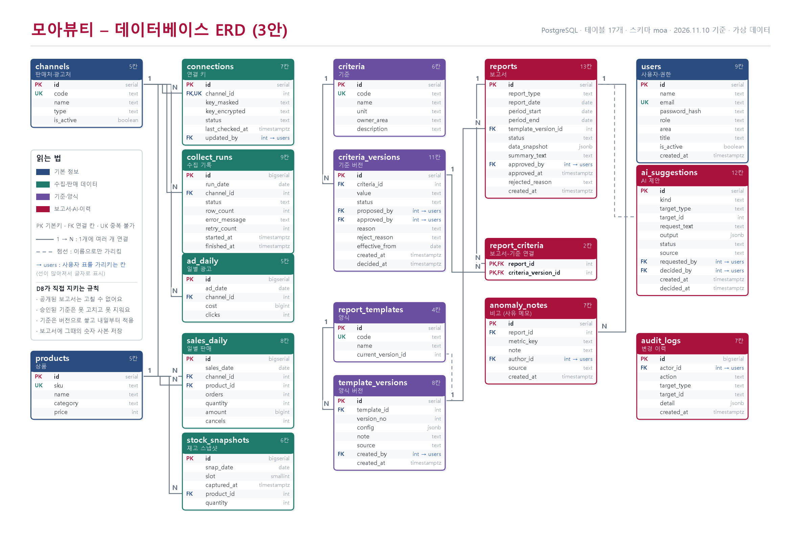

# 모아뷰티 일일 보고서 자동화 기획서

> 작성 단계: 전체 작성본 (선택안: 3안 자체 프로그램)
> 구성: 고객과 배경 ~ To-Be(1·2·3안 제안) → 사용자 / 화면 목록 / 데이터 설계 / 규칙 / 백엔드 기능 목록 / 비용·운영 방법 / 완료 기준 / 필수 기능 대조표
> 숫자 중 "가정"이라고 적은 것은 확정된 값이 아니라 과제용으로 정한 값입니다.

**알림**: 이 문서의 회사, 사람, 숫자는 모두 **과제용 가상 설정**입니다. 실제 개인정보, 결제 정보는 사용하지 않습니다.

**과제 조건**

- 화면(프론트엔드): Next.js, 서버(백엔드): NestJS, 데이터 저장(DB): PostgreSQL
- 배포: 화면은 Vercel, 서버와 DB는 Render
- 회사 규모: 상위 중소기업 (3안 우선 고려)
- 보고서 양식이 **매번 바뀔 수 있고**, **그래프가 포함**됨

---

## 목차

1. 고객과 배경
2. 고객의 요청
3. 진짜 문제
4. 현재 업무 흐름 (As-Is)
5. To-Be (개선된 업무 흐름)
    - 5.1 설계 원칙 (양식과 기준 구분, 사용자 4단계, AI 사용 원칙, 양식·샘플·기준표 초기 구성 포함)
    - 5.2 6단계 공통 흐름
    - 5.3 안별 제안 (1안 스킬, 2안 상용+자동화, 3안 자체 프로그램)
    - 5.4 세 안 비교
    - 5.5 선택 가이드
    - 5.6 선택안(3안) 담당자별 As-Is와 To-Be 비교
6. 사용자
7. 화면 목록 (반응형·디자인 기준 포함)
8. 데이터 설계 (DB 테이블, 칸, 관계, 가상 데이터 계획)
9. 규칙
10. 백엔드 기능 목록
11. 비용·운영 방법
12. 완료 기준
13. 필수 기능 대조표 (필수 기능과 추가 기능)

- 부록 A. 고객 인터뷰 기록

---

## 1. 고객과 배경

| 항목 | 내용 |
|---|---|
| 회사 | 모아뷰티 (가상) · 화장품 온라인 판매 · 직원 약 150명 |
| 판매처 | 자사몰 1곳, 오픈마켓 3곳 (스마트스토어, 쿠팡, 11번가) |
| 광고 | 3곳 (네이버 검색광고, 인스타·페이스북 광고, 쿠팡 광고) |
| 규모 | 상품 약 150개 (옵션 포함 300종), 하루 주문 평일 약 400건, 이벤트 때 약 1,500건 |
| 보고서 | 매일 오전 10시 임원 회의용 · 일일 / 주간 / 월말 3가지 양식 |
| 담당자 | 운영 2명, 마케팅 1명, 재고 1명, 이사 1명(확인·승인), 대표(보기만) |
| 제약 | 개발자가 없고, 월 운영비 10~30만 원 이내, 구축비를 크게 쓰기 어려움 |

**요청한 사람**: 마케팅·운영 이 이사

---

## 2. 고객의 요청

이 이사가 한 말을 그대로 옮기면 다음과 같습니다.

1. "자사몰, 오픈마켓, 광고 세 군데 숫자를 따로 봐야 해서 매일 오전이 다 갑니다."
2. "대표님은 매출과 광고비를 한 그래프로 보고 싶어 하세요."
3. "월말에는 보고서 양식이 완전히 다른데, 그때마다 새로 만들어요."
4. "재고가 부족한 상품은 빨갛게 표시해 달라는 요청도 있습니다."
5. "담당자가 휴가 가면 보고서를 만들 사람이 없어요."

**요청을 한 줄로 줄이면**: 매출, 광고, 재고를 한 번에 모아 그래프가 있는 보고서를 사람 손 없이 만들고, 양식이 바뀌어도 쉽게 대응하고 싶다.

---

## 3. 진짜 문제

| 고객의 말 | 진짜 문제 |
|---|---|
| 세 군데 숫자를 따로 봐서 오전이 다 간다 | 숫자를 **보는 시간**이 아니라 **모으고 합치는 시간**이 하루를 차지한다. 곳마다 파일 모양이 달라 사람이 맞춰야 한다. |
| 매출과 광고비를 한 그래프로 | 대표가 알고 싶은 것은 숫자가 아니라 **광고비를 쓴 만큼 매출이 났는지**(광고 효율)다. 이 기준이 정해져 있지 않다. |
| 월말에는 양식이 완전히 다르다 | 양식이 바뀌는 **이유와 규칙이 없고**, 바뀔 때마다 사람이 처음부터 다시 만든다. |
| 재고 부족은 빨갛게 | 부족 기준이 담당자의 **감**에 있고, 사람이 눈으로 찾는다. (고객 기준: 10개 이하, 또는 7일 평균 판매 기준 3일치 미만) |
| 휴가 가면 만들 사람이 없다 | 방법이 **한 사람 머릿속**에만 있고, 확인·승인 절차가 문서로 없다. |

**한 문장으로**: 문제는 "보고서를 못 만드는 것"이 아니라, **흩어진 데이터를 사람이 손으로 모으고, 양식이 바뀔 때마다 처음부터 다시 만드는 구조**다.

---

## 4. 현재 업무 흐름 (As-Is)

*그림 4-1. 담당자별 As-Is 맵 (원본 파일: As-Is_맵.drawio). 파란색은 일반 단계, 빨간색은 시간·실수가 생기는 지점이다. 그림을 누르면 원본 크기로 열린다.*

### 4.1 담당자별 현재 업무

| 담당자 | 하는 일 | 도구 | 걸리는 시간 |
|---|---|---|---|
| 운영 담당 (2명) | 자사몰·오픈마켓 4곳 관리자 화면에서 주문·매출 엑셀 다운로드 | 쇼핑몰 관리자, 엑셀 | 약 40분 |
| 마케팅 담당 | 광고 3곳에서 광고비·클릭 수 엑셀 다운로드 | 광고 관리자, 엑셀 | 약 30분 |
| 재고 담당 | 창고 재고를 엑셀로 정리해 메일 발송 (하루 2번) | 엑셀, 메일 | 약 20분 × 2 |
| 이 이사 | 엑셀 여러 개를 합치고 계산, 그래프 제작, 보고서 작성 | 엑셀, 워드 | 약 1시간 |
| 대표 | 보고서를 보고 질문, 양식 변경 요청 (당일 변경 있음) | 메일, 카톡 | - |

### 4.2 단계별 문서·데이터

| 단계 | 문서·데이터 | 문제 |
|---|---|---|
| ① 매출 수집 | 판매처 4곳 주문 엑셀 4개 | 곳마다 칸 이름과 모양이 다름 |
| ② 광고 수집 | 광고 성과 엑셀 3개 | 광고비 단위와 기준이 다름 |
| ③ 재고 정리 | 재고 엑셀 1개 (하루 2번 갱신) | 갱신 시각에 따라 숫자가 달라짐 |
| ④ 합치기·계산 | 합친 엑셀, 계산 시트 | 복사·붙여넣기로 숫자가 틀릴 수 있음 |
| ⑤ 그래프·보고서 | 워드 보고서 (양식 3종) | 양식이 바뀌면 처음부터 다시 만듦 |
| ⑥ 확인·배포 | 메일 첨부, 폴더 저장 | 지난 보고서를 찾기 어려움 |

### 4.3 문제를 모으면
- 파일이 8개 이상 흩어져 있다. (판매처 4 + 광고 3 + 재고 1)
- 하루 약 **2시간**이 모으고 합치는 일에 쓰인다.
- 양식 변경, 당일 변경에 대응하기 어렵다.
- 한 사람이 빠지면 보고서가 멈춘다.
- 지난 보고서와 비교하기 어렵다.

---

## 5. To-Be (개선된 업무 흐름)

### 5.1 설계 원칙

**누가 무엇을 하는가 (역할 구분)**

| 구분 | 맡는 일 | 예 |
|---|---|---|
| **사람** | 판단, 확인, 승인, 예외 처리 | 이사가 보고서를 확인하고 승인 |
| **시스템** | 정해진 규칙대로 반복하는 일 | 데이터 수집, 계산, 그래프 그리기, 저장, 기록 |
| **AI** | 규칙으로 정하기 어려운 글·판단 보조 (제안과 초안까지) | 양식 변경안 만들기, 이상 숫자의 원인 후보와 사유 초안, 재고 소진 예측 설명과 발주 제안, 요약 문장 |

**공통 원칙**
1. **사람이 하던 모으기·합치기·계산·그래프는 시스템이** 한다. 사람은 확인과 승인만 한다.
2. **엑셀로 충분한 곳은 엑셀로 둔다.** (비용 이유: 자동 연동은 개발비와 관리 비용이 든다)
3. **양식이 바뀌어도 프로그램을 고치지 않는다.** 양식은 설정이나 파일 교체로 바꾼다.
4. **승인 없이 배포되지 않는다.** 이사 승인 후에만 대표와 팀장에게 나간다.
5. 모든 데이터는 가상 데이터로 시연한다.
6. **양식 변경과 기준 관리를 나눈다.** 양식은 모양, 기준은 계산과 판단이다. (아래 5.1-2)
7. **기준 변경은 승인을 거치고, 당일에는 적용되지 않는다.** 사용자가 수정안을 쓰고 관리자가 승인하면, 승인한 다음 날부터 적용된다.
8. **과거 데이터는 바꾸지 않는다.** 기준을 바꿔도 지난 보고서와 숫자는 그때의 기준 그대로 유지된다.
9. **AI는 제안과 초안까지만 한다.** 숫자 계산은 시스템이 하고, AI가 낸 결과는 사람이 확인해야 반영된다. (9.10)

### 5.1-2 양식 변경과 기준 관리

| 구분 | 바꾸는 것 | 예 | 누가 | 제한 |
|---|---|---|---|---|
| **양식** (모양) | 항목 배치, 순서, 그래프 종류, 로고, 문구 | 막대 그래프를 꺾은선으로, 항목 순서 변경 | 이사, 운영 담당 | 당일 변경 가능, 숫자는 바뀌지 않음 |
| **기준** (계산과 판단) | 계산식, 경고 기준, 기간 | 광고 효율 계산법, 재고 부족 기준(10개 이하, 3일치 미만), 주의·위험 구분 | 사용자가 수정안 작성(담당 영역만), 관리자가 승인 | **당일 적용 불가** (승인 다음 날부터), 변경 이력 기록 |

**기준 변경 규칙**
- **변경 방법**: 사용자가 **수정안**을 작성하고(담당 영역만: 재고 기준은 재고 담당, 광고 효율은 마케팅 담당 등, 가정), 관리자가 **승인**하면 확정된다.
- **당일 변경 불가**: 승인한 날의 보고서에는 적용하지 않고, **승인 다음 날부터** 적용한다. 급한 당일 변경 예외는 두지 않는다.
- **과거 데이터 유지**: 지난 보고서와 숫자는 그대로 두고, **어떤 기준 버전으로 만들었는지**를 함께 저장한다.
- **이력**: 누가 제안하고 누가 승인했는지, 언제 무엇을 바꿨는지 남기고, 이전 버전으로 되돌릴 수 있다.
- **양식은 다르다**: 양식은 숫자가 바뀌지 않으므로 **당일 변경이 가능**하다. (고객 요청: 가끔 당일에 바뀜)

### 5.1-3 사용자 구분 (권한 4단계)

| 단계 | 누구 | 할 수 있는 일 | 할 수 없는 일 |
|---|---|---|---|
| **조회자** | 대표, 팀장 5명 | **승인된** 보고서 보기·다운로드 | 설정·수정 전부 |
| **사용자** | 운영·마케팅·재고 담당 | 수집 상태 확인·재시도, 이상 숫자 **사유 메모**, 양식 설정, 기준 **수정안 작성**(담당 영역만), 보고서 조회 | 승인, 기준 직접 반영, 계정·키 관리 |
| **관리자** | 이 이사 | 보고서 승인·반려, 기준 수정안 승인·반려, 승인 전 보고서 보기 | 계정·권한, 연결 키 관리 |
| **총관리자** | 운영 담당 1명 (겸임) | 계정·권한, 연결 키 등록·교체, 백업·보관 점검 | 보고서와 기준의 승인 (승인은 관리자 몫) |

- 대표는 직급이 가장 높아도 화면에서는 **조회자**다. 권한은 "할 일"로 정하고, 직급으로 정하지 않는다.
- 데이터는 **모두 DB로 자동 수집**되므로 사용자의 입력 업무는 없고, **예외 확인, 사유 메모, 양식 설정, 기준 수정안 작성**이 사용자의 일이다.
- 인원이 6명 규모라서 총관리자는 별도 인원이 아니라 겸임이다. 인원이 늘면 겸임을 풀면 된다.

### 5.1-4 양식 3종, 샘플, 기준표 초기 구성

"가정"이라고 적은 값은 과제용으로 정한 값이다.

**보고서 양식 3종**

| 양식 | 읽는 때 | 들어가는 내용 |
|---|---|---|
| 일일 | 매일 아침 | 핵심 숫자(매출, 전일 대비, 주문, 광고 효율, 취소율), 그래프 5종, 재고 경고, 사유 메모, 요약 문장(선택) |
| 주간 | 월요일 아침 | 지난 7일 합계와 전주 대비, 일별 매출·광고비, 판매처별·상품별 순위, 광고 효율 4주 추이, 재고 경고 횟수 |
| 월말 | 다음 달 첫 영업일 | 월 합계와 전월 대비, 월 매출 목표 달성률, 광고비 대비 매출 월 추이, 상품 순위 20개, 취소율 추이 |

**샘플**

| 샘플 | 내용 | 구분 |
|---|---|---|
| 양식 샘플 (JSON) | 항목·순서·그래프 설정과 설명이 들어 있어서, 내려받아 고쳐 다시 올리는 파일 (구현 시 .docx에서 JSON으로 바꿈) | 필수 |
| 일일 완성 예시 (PDF) | 가상 데이터로 채운 일일 보고서 1건 | 필수 |
| 주간·월말 완성 예시 (PDF) | 각 1건 | 추가 |

**기준표 초기값**

| 코드 | 항목 | 값 | 담당 영역 | 근거 |
|---|---|---|---|---|
| stock_warn_qty | 재고 주의 수량 | 10개 이하 | 재고 | 고객 말 (Q8) |
| stock_warn_days | 재고 주의 일수 | 3일 미만 | 재고 | 고객 말 (Q8) |
| stock_danger_qty | 재고 위험 수량 | 3개 이하 | 재고 | 가정 |
| stock_danger_days | 재고 위험 일수 | 1일 미만 | 재고 | 가정 |
| avg_sales_period | 평균 판매 기간 | 7일 | 재고 | 고객 말 (Q8) |
| ad_efficiency | 광고 효율 | 매출 ÷ 광고비 | 마케팅 | 고객 말 (Q4) |
| sales_basis | 매출 집계 기준 | 완료 주문만 (취소 제외) | 운영 | 9.2 |
| top_n | 상품 순위 개수 | 10개 (월말은 20개) | 운영 | Q5, 가정 |
| missing_alert | 누락 의심 기준 | 전일의 50% 미만 | 운영 | 가정 |
| monthly_target | 월 매출 목표 | 10억 원 | 관리자 | 가정 |
| stock_target_days | 목표 재고 일수 (발주 제안 기준) | 7일 | 재고 | 가정 |

- 1안에서는 이 표를 **엑셀 파일**로 쓰고, 3안에서는 기준 테이블(criteria, criteria_versions)의 **처음 데이터**로 넣는다. 두 안이 같은 값에서 출발한다.
- 열은 코드, 항목, 값, 단위, 담당 영역, 적용 시작일, 변경 사유로 한다.

### 5.2 6단계 공통 흐름

| 단계 | 하는 일 | 주로 맡는 쪽 |
|---|---|---|
| ① 입력 | 판매, 광고, 재고 데이터를 받는다 | 시스템 (또는 사람이 파일 전달) |
| ② 처리 | 합치고 계산하고 경고를 판단하고 그래프를 만든다 | 시스템 (AI는 요약 보조) |
| ③ 승인 | 이사가 결과를 확인하고 승인한다 | **사람** |
| ④ 결과 | 보고서를 만들어 배포한다 | 시스템 |
| ⑤ 저장 | 보고서와 원본 숫자를 보관한다 | 시스템 |
| ⑥ 기록 | 누가 언제 무엇을 했는지 남긴다 | 시스템 |

세 안은 **같은 6단계**를 쓰고, **①입력과 ⑤저장, 양식 관리 방식**이 서로 다릅니다.

---

### 5.3 안별 제안

### 1안. Claude 스킬 + 로컬 파일 (가장 가볍게)

**한 줄 소개**: 담당자가 엑셀 파일을 정해진 폴더에 넣고 Claude에게 "오늘 보고서 만들어줘"라고 말하면, 스킬이 합치고 계산해서 보고서(워드)를 만든다.

| 단계 | 사람 | 시스템·도구 | AI (Claude) |
|---|---|---|---|
| ① 입력 | 판매처·광고·재고 엑셀을 내려받아 폴더에 저장 | 폴더 (날짜별 구분) | - |
| ② 처리 | "보고서 만들어줘" 요청 | 기준표(엑셀)에 따라 스킬이 계산 | 파일을 읽고 합산, 그래프 생성, 요약 문장 작성 |
| ③ 승인 | 이사가 결과 확인 | - | 이상한 숫자가 있으면 알려줌 |
| ④ 결과 | 이사가 승인 후 메일·메신저로 직접 전달 | 워드 파일 생성 | - |
| ⑤ 저장 | - | 날짜별 폴더에 보관 | - |
| ⑥ 기록 | - | 기록용 엑셀 시트에 한 줄 추가 | - |

**양식 변경**: 양식 파일(워드)을 교체하면 끝. 프로그램 수정 없음.
**기준 관리**: 기준표(엑셀)를 수정. 날짜가 붙은 사본으로 보관(예: 기준표_2026-11-10.xlsx)해서 과거 기준을 남긴다. 당일 변경 금지(승인 다음 날부터 적용)는 **사람이 지키는 규칙**이라 시스템이 막지는 못한다.
**엑셀로 하는 것**: 입력 전부, 기준표, 기록.
**비용·운영**: 추가 비용이 거의 없음 (이미 쓰는 Claude 이용 범위). 운영은 담당자 1~2명.
**장점**: 가장 빠르게 도입, 비용 최저, 양식 변경 쉬움.
**한계**: 엑셀을 사람이 내려받아야 함, 한 PC 중심이라 팀 동시 사용과 권한 구분이 어려움, 승인 기록이 약함.

---

### 2안. 상용 시스템 + 자동화 (이미 있는 도구를 엮기)

**한 줄 소개**: 판매처 통합관리 서비스, 자동화 도구, 스프레드시트·노션 같은 **이미 만들어진 도구를 연결**해서 쓴다. 직접 개발하지 않는다.

| 단계 | 사람 | 시스템·도구 | AI |
|---|---|---|---|
| ① 입력 | 재고 엑셀만 업로드 | 상용 서비스가 판매처·광고를 가능한 만큼 자동 수집 | - |
| ② 처리 | - | 스프레드시트 수식과 자동화 규칙으로 합산·계산 | 요약 문장 작성 (선택) |
| ③ 승인 | 이사가 확인 후 승인 표시 | 상태 칸(작성중/승인)으로 구분 | - |
| ④ 결과 | - | 승인되면 자동으로 보고서 생성·전달 | - |
| ⑤ 저장 | - | 도구 내 문서함에 보관 | - |
| ⑥ 기록 | - | 도구가 제공하는 변경 이력 | - |

**양식 변경**: 도구의 템플릿 설정에서 바꿈. 단, **도구가 허용하는 범위 안에서만** 가능.
**기준 관리**: 스프레드시트의 수식과 설정을 수정. 과거 유지는 날짜별 시트 복사본으로 한다. 승인과 당일 변경 금지는 도구 기능으로 걸기 어려워 **운영 규칙**에 의존한다.
**엑셀로 하는 것**: 재고 (연동 비용 대비 효과가 낮음), 자동 수집이 안 되는 광고처.
**비용·운영**: 월 구독료 (도구 여러 개 합산, 가정 월 10~30만 원). 운영은 담당자 1명이 연결 상태를 점검.
**장점**: 개발 없이 빠르게 시작, 협업과 이력 기능이 기본 제공.
**한계**: 도구마다 요금이 따로 나가고, **양식을 마음대로 바꾸기 어렵고**, 도구가 정책을 바꾸면 영향을 받음.

---

### 3안. 자체 프로그램 (Next.js + NestJS + PostgreSQL)

**한 줄 소개**: 모아뷰티 전용 웹사이트를 만든다. 판매처·광고·재고 데이터를 **모두 자동 수집**해 DB에 쌓고, 화면에서 양식과 그래프를 설정해 보고서를 만든다.

| 단계 | 사람 | 시스템 | AI |
|---|---|---|---|
| ① 입력 | 입력 업무 없음 (수집 실패 때만 재시도, 이상 숫자에는 사유 메모) | 판매처 4곳·광고 3곳·재고를 **정해진 시간에 자동 수집** (과제에서는 가상 수집기) | - |
| ② 처리 | 이상 숫자의 원인 후보 확인, 사유 메모 작성, 재고 발주 여부 결정 | 합치기, 계산, 광고 효율, 재고 경고, 그래프 생성, 재고 소진 예상일·권장 발주 수량 계산 | 원인 후보와 사유 초안, 재고 제안 문장, 요약 문장 초안(선택) |
| ③ 승인 | 이사가 승인 화면에서 보고서와 기준 수정안을 확인·승인·반려 | 승인 전에는 배포 차단, 승인된 기준은 다음 날부터 적용 | - |
| ④ 결과 | - | 보고서 파일 생성, 지정한 사람에게 배포 | - |
| ⑤ 저장 | - | PostgreSQL에 원본 숫자·보고서·양식 버전 저장 | - |
| ⑥ 기록 | - | 수집 성공/실패, 승인, 양식 변경 이력 저장 | - |

**양식 변경**: 화면에서 양식(항목, 순서, 그래프 종류)을 설정하거나 양식 파일을 업로드. **개발자 없이** 바꿈. 샘플 양식 다운로드 제공. 이전 버전으로 되돌리기 가능.
**AI 활용 (3가지, 필수)**: ① **양식 변경 도우미** — "광고 효율 그래프를 맨 위로 올려줘"처럼 말하면 AI가 양식 변경안을 만들고, 사용자가 변경 전후 미리보기를 확인한 뒤 적용한다. ② **원인 후보·사유 초안** — 매출이 급증·급감하거나 경고가 뜬 숫자에 원인 후보를 근거 숫자와 함께 보여 주고 사유 메모 초안을 쓴다. ③ **재고 소진 예측·발주 제안** — 소진 예상일과 권장 발주 수량은 시스템이 계산하고, AI가 "내일 품절이 예상돼요. 3일치 발주를 권해요"처럼 설명한다. 요약 문장 초안은 추가 기능이다. 규칙은 9.10에 있다.
**기준 관리 (별도 화면)**: 계산식, 재고 경고 기준, 기간을 관리한다. **사용자는 수정안을 작성**(담당 영역만)하고 **관리자가 승인**해야 확정된다. 승인한 **다음 날부터** 적용되고, **당일 변경은 시스템이 막는다.** 지난 보고서와 숫자는 **그때의 기준 버전과 함께 저장**되어 그대로 유지된다. 제안자·승인자 이력 조회와 되돌리기 제공.
**자동으로 하는 것**: 판매처·광고·재고 수집 전부 (사람이 가장 많은 시간을 쓰는 부분).
**엑셀 업로드**: 실제 도입 때 창고 시스템 연동이 어렵거나 비용이 클 경우의 **대체 입력 경로**로만 열어 둔다. (가상 데이터 시연에서는 DB 방식만 사용)
**배포**: 화면은 Vercel, 서버와 DB는 Render.
**그래프 추가 (구현 시 더한 기능)**: 양식 설정에서 "무엇을(매출·주문 수·판매 수량·취소 건수) × 무엇별로(판매처·상품·카테고리·날짜) × 어떤 모양으로(원·가로 막대·표·꺾은선·세로 막대)"를 골라 새 그래프를 추가한다. 양식마다 3개까지이고, 숫자는 시스템이 계산하며 안 되는 조합은 고를 수 없다. AI 양식 도우미에게 말로 시켜도 되고, 광고 효율·취소율 같은 비율 숫자는 합치면 틀려져서 뺐다.
**구현 결과 (2026-11 로컬 구현)**: Next.js 화면 + NestJS 서버 + PostgreSQL(전용 스키마 `moa`)로 만들었다. PDF는 pdfmake로 생성하고, AI는 GPT(gpt-4.1-mini)를 쓰되 실패하면 규칙 기반 예시 답변으로 바꾼다. 양식 샘플·업로드는 JSON이고, 발표용 **시연 컨트롤 화면**(바로 수집·보고서 생성·실패 시연·데이터 초기화, 관리자 전용)을 추가했다. 배포와 단위 테스트는 아직 하지 않았다.
**비용·운영**: 호스팅비 월 수만 원대 (가정, 실제 요금제 확인 필요) + 구축비 일회성. 운영은 담당자 1명이 수집 실패 알림과 양식 설정을 관리.
**장점**: **양식 자유도 최고**, 승인·이력·권한이 정확, 수집 자동화로 시간 절감 효과 최대.
**한계**: 구축 기간과 비용이 가장 큼, 판매처·광고 플랫폼이 연동 방식을 바꾸면 수정이 필요, 실제 연동에는 각 플랫폼의 계정 승인이 필요함 (과제에서는 가상 수집기로 대체).

---

### 5.4 세 안 비교

| 비교 | 1안 스킬+로컬 파일 | 2안 상용+자동화 | 3안 자체 프로그램 |
|---|---|---|---|
| 판매처·광고 입력 | 사람이 엑셀 전달 | 가능한 곳 자동, 나머지 엑셀 | **자동 수집** |
| 재고 입력 | 엑셀 | 엑셀 | **자동 수집** (대체 경로: 엑셀 업로드) |
| 사람 일 (하루) | 파일 받기·전달 약 1시간 | 재고 업로드·확인 약 20분 | 승인·예외 확인 약 10분 |
| 양식 변경 | 파일 교체 (쉬움) | 도구 범위 안에서 | **화면에서 자유롭게** |
| 승인·이력 | 약함 (폴더·시트) | 도구 기본 기능 | **정확함** (화면·기록) |
| 기준 변경 승인·당일 적용 불가 | 사람이 지킴 | 운영 규칙에 의존 | **시스템이 강제** |
| 과거 데이터 유지 | 날짜별 사본 파일 | 날짜별 시트 복사 | **기준 버전과 함께 자동 저장** |
| 팀 동시 사용 | 어려움 | 가능 | 가능 (권한 구분) |
| 월 비용 (가정) | 거의 없음 | 10~30만 원 | 수만 원대 + 구축비 |
| 구축 부담 | 가장 낮음 | 낮음~중간 | 가장 높음 |
| 휴가·퇴사 대응 | 파일 규칙 문서에 의존 | 도구 설정에 의존 | 시스템에 남음 |
| AI 활용 | Claude가 파일을 읽고 요약·설명 | 도구가 제공하는 AI 기능 범위 | **양식 변경 도우미, 원인 후보, 재고 제안** |

### 5.5 선택 가이드

- **비용이 최우선, 담당자 1~2명이 쓴다** → 1안
- **개발 없이 팀 협업이 필요하고 양식 요구가 단순하다** → 2안
- **양식이 자주 바뀌고, 승인·이력이 중요하며, 반복 수작업을 줄이는 효과가 크다** → 3안 (과제에서 우선 고려 중인 안)

모아뷰티의 상황(양식 변경 잦음, 당일 변경, 승인 필요, 휴가 시 공백)은 **3안의 장점과 가장 잘 맞습니다.** 다만 "월 10~30만 원, 개발자 없음" 조건 때문에 **운영을 단순하게** 가고, 판매처·광고·재고는 모두 자동 수집으로 시연하되 재고 연동이 어려우면 엑셀 업로드를 대체 경로로 두는 방식을 제안합니다.

---

### 5.6 선택안(3안) 담당자별 As-Is와 To-Be 비교

*그림 5-1. 3안 담당자별 To-Be 맵 (원본 파일: To-Be_3안_맵.drawio). 4장의 As-Is 맵(그림 4-1)과 같은 담당자 줄에 시스템, AI, 총관리자 줄을 더했다. 그림을 누르면 원본 크기로 열린다.*

**담당자별 As-Is와 To-Be 비교표**

| 담당 | As-Is (현재) | To-Be (3안) | 변화 |
|---|---|---|---|
| 운영 담당 | 판매처 4곳 엑셀 다운로드 약 40분 | 수집 실패 확인·재시도(실패 때만), 양식·그래프 설정 | 약 40분 → 예외 때만 |
| 마케팅 담당 | 광고 3곳 엑셀 다운로드 약 30분 | 기준 수정안 작성(광고 효율 등), 보고서 확인 | 약 30분 → 필요할 때만 |
| 재고 담당 | 재고 엑셀 정리·메일 (하루 2번, 각 약 20분) | 이상 숫자 사유 메모, 재고 기준 수정안 작성 | 약 40분 → 필요할 때만 |
| 이 이사 | 합치기·계산·그래프·보고서 작성 약 1시간 | 보고서 확인·승인/반려 약 5분, 기준 수정안 승인 | 약 1시간 → 약 5분 |
| 대표 | 보고서 확인, 양식 변경 요청 | 화면에서 확인·다운로드, 양식 변경 요청 | 보는 방식만 달라짐 |
| 시스템 (신규) | - | 자동 수집, 계산, 경고, 그래프, 보고서 생성, 저장, 기록 | 사람이 하던 모으기·합치기 전부 |
| AI (신규) | - | 양식 변경안, 원인 후보·사유 초안, 재고 소진 예측·발주 제안 (요약 초안은 선택) | 신규, 제안까지만 |
| 총관리자 (신규) | - | 연결 키, 계정·권한, 백업 점검 (운영 담당 1명 겸임) | 신규 |

**시간 효과 (가정)**: As-Is 담당자 시간 합계 약 170분 → To-Be 사람 일 약 10분 (이사 승인 약 5분 + 확인 약 5분, 나머지는 예외가 있을 때만).

---

## 6. 사용자

### 6.1 사용자와 목표

| 단계 | 사용자 | 목표 | 하루 흐름 (가정) |
|---|---|---|---|
| 조회자 | 대표, 팀장 5명 | 아침 회의 전에 보고서를 보고 판단한다 | 10시 회의 전 화면에서 보고서 확인, 필요하면 PDF 다운로드 |
| 사용자 | 운영 담당 2명, 마케팅 담당, 재고 담당 | 수집이 잘 되는지 보고, 숫자 뒤의 이유와 기준 수정안을 남긴다 | 수집 상태 확인, 이상 숫자에 사유 메모, 가끔 양식 설정·기준 수정안 작성 |
| 관리자 | 이 이사 | 보고서와 기준 변경이 맞는지 확인하고 승인한다 | 9시 10분 이후 보고서 확인·승인, 승인 대기 기준 수정안 처리 |
| 총관리자 | 운영 담당 중 1명 (겸임) | 시스템이 안전하게 돌아가게 한다 | 계정·권한, 연결 키 등록·교체, 백업 점검 |

대표는 직급이 가장 높아도 화면에서는 **조회자**다. 권한은 직급이 아니라 **할 일**로 정한다.

### 6.2 기능별 권한표

○ 가능 / × 불가 / △ 조건부

| 기능 | 조회자 | 사용자 | 관리자 | 총관리자 |
|---|---|---|---|---|
| 승인된 보고서 보기·다운로드 | ○ | ○ | ○ | ○ |
| 승인 전 보고서 보기 | × | × | ○ | ○ |
| 수집 상태 보기·재시도 | × | ○ | ○ | ○ |
| 이상 숫자 사유 메모 | × | ○ | ○ | × |
| 양식 설정·업로드 | × | ○ | ○ | × |
| AI 양식 변경 도우미 사용 | × | ○ | ○ | × |
| AI 원인 후보·사유 초안 사용 | × | ○ | ○ | × |
| 기준 수정안 작성 | × | △ (담당 영역만) | ○ | × |
| 기준 수정안 승인·반려 | × | × | ○ | × |
| 보고서 승인·반려 | × | × | ○ | × |
| 사용자·권한 관리 | × | × | × | ○ |
| 연결 키 등록·교체 | × | × | × | ○ |
| 이력 조회 | × | △ (본인 것만) | ○ | ○ |
| 백업·보관 점검 | × | × | × | ○ |

---

## 7. 화면 목록

화면은 Next.js로 만들고 Vercel에 올린다. 흐름: 로그인 → 보고서 목록 → 보고서 상세 (관리자는 승인 화면에서 확인).

| 번호 | 화면 | 쓰는 사람 | 하는 일 | 구분 |
|---|---|---|---|---|
| S01 | 로그인 | 전체 | 로그인, 역할에 따라 메뉴가 다르게 보임 | 필수 |
| S02 | 보고서 목록 | 전체 | 날짜·양식별 검색, 승인 상태 표시 | 필수 |
| S03 | 보고서 상세 | 조회자 (승인된 것만), 사용자·관리자·총관리자 (승인 전 포함) | 화면에서 보기(표·그래프 5종·경고·사유 메모·요약·재고 AI 제안), PDF 다운로드 | 필수 |
| S04 | 승인 화면 | 관리자 | 보고서 확인·승인·반려(사유 입력), 기준 수정안 승인 대기 목록 | 필수 |
| S05 | 수집 상태 | 사용자 이상 | 판매처·광고·재고별 성공/실패, 재시도, 실패 기록 | 필수 |
| S06 | 사유 메모 | 사용자, 관리자 | 경고·이상 숫자에 이유 입력. AI가 원인 후보와 사유 초안을 보여 주고, 고쳐서 저장 (보고서 상세 안에서도 가능) | 필수 |
| S07 | 양식 설정 | 사용자, 관리자 | 양식 선택(일일·주간·월말), 항목·순서·그래프 설정, AI 변경 도우미 입력창(변경 전후 미리보기), 양식 파일 업로드, 샘플 다운로드, 버전 이력·되돌리기 | 필수 |
| S08 | 기준 관리 | 사용자(수정안), 관리자(승인) | 기준 목록, 수정안 작성, 적용 예정일 확인, 승인 대기·이력 | 필수 |
| S09 | 사용자·권한 관리 | 총관리자 | 계정 만들기·정지, 역할과 담당 영역 지정 | 필수 |
| S10 | 연결 정보 관리 | 총관리자 | 판매처·광고·재고 연결 키 등록·교체, 연결 상태 | 필수 |
| S11 | 이력 | 관리자·총관리자 (전체), 사용자 (본인) | 누가 언제 무엇을 했는지 검색 | 필수 |
| S12 | 백업·보관 점검 | 총관리자 | 백업 상태, 보관 기간 확인 | 추가 |
| S13 | 재고 현황 | 전체 | 현재 재고와 주의·위험 표 (오후 갱신분 포함) | 추가 |

### 7.1 화면 크기별 배치 (반응형)

- **모든 화면은 휴대폰과 PC에서 쓸 수 있다.** 관리자의 승인 화면도 휴대폰에서 쓸 수 있다.
- 화면 폭이 약 768px 이상이면 **PC 배치**(위쪽 가로 메뉴, 카드 2열, 파란 버튼은 위쪽)로, 그보다 좁으면 **휴대폰 배치**(카드를 한 줄로 쌓기, 파란 버튼은 맨 아래)로 바뀐다. (가정)
- 보여 주는 정보는 같고 배치만 다르다. PC에서만 빠지는 정보는 없다.
- **메뉴는 역할별로 보이는 항목이 다르다.** 조회자는 보고서·재고·이력, 사용자는 보고서·수집·양식·기준(수정안), 관리자는 보고서·승인·기준·양식, 총관리자는 계정·연결·백업이다.

### 7.2 디자인 기준

토스 디자인 가이드(`toss.md`)를 따른다. 디자인 시안(휴대폰 보고서 상세, PC 보고서 상세, PC 승인 화면)은 화면으로 확인했고, 이 문서에는 규칙만 적는다.

- 강조색은 토스 블루 하나이고, **파란 채움 버튼은 화면당 하나**만 쓴다.
- 카드는 둥글기 16~24px, 버튼은 크기에 따라 12~16px, 칩과 상태 표시는 알약 모양이다.
- 그래프는 축 선 없이 막대만 그리고, 강조할 막대(예: 어제)만 파랑, 나머지는 회색이다. 축은 하나만 쓴다.
- 숫자는 칸을 맞춘 숫자 글꼴이고, 오른 값은 파랑, 내린 값은 검정이다.
- 문구는 해요체로 쓴다. ("확인해 주세요", "내려받기")

---

## 8. 데이터 설계

PostgreSQL에 저장한다. 칸 이름 옆의 괄호는 쉬운 뜻이다. 아래 그림은 3안으로 구현한 17개 테이블의 관계이고, 색깔은 역할별 묶음이다.

*그림 8-1. 3안 DB ERD (원본 파일: 3안_DB_ERD.png, 확대해도 깨지지 않는 파일: 3안_DB_ERD.svg). 파랑은 기본 정보, 초록은 수집·판매 데이터, 보라는 기준·양식, 빨강은 보고서·AI·이력이다. 사용자(users)를 가리키는 칸은 선 대신 "→ users"로 적었다. 그림을 누르면 원본 크기로 열린다.*

### 8.1 테이블과 칸

| 테이블 | 주요 칸 | 설명 |
|---|---|---|
| users (사용자) | id, name(이름), email(로그인 ID), password_hash(암호화된 비밀번호), role(역할: 조회자·사용자·관리자·총관리자), area(담당 영역: 운영·마케팅·재고·없음), title(직함), is_active(사용 여부), created_at | 로그인하는 사람과 권한 |
| channels (수집처) | id, code(코드), name(이름), type(판매·광고·재고), is_active(사용 여부) | 판매처 4곳, 광고 3곳, 재고 |
| connections (연결 정보) | id, channel_id(수집처당 1개), key_masked(가린 표시), key_encrypted(암호화된 연결 키), status(상태), last_checked_at(마지막 확인), updated_by(바꾼 사람) | 수집처 연결 방법 (키 원문은 화면에 안 보임) |
| collect_runs (수집 기록) | id, run_date(수집일), channel_id, status(성공·실패·일부), row_count(받은 건수), error_message(오류 내용), retry_count(재시도 횟수), started_at, finished_at | 수집이 잘 됐는지 기록 |
| products (상품) | id, sku(상품 코드), name(상품명), category(분류), price(판매가) | 상품 150개 |
| sales_daily (일별 판매) | id, sales_date(날짜), channel_id, product_id, orders(주문 건수), quantity(수량), amount(금액), cancels(취소 건수) | 판매처·상품별 하루 판매 |
| ad_daily (일별 광고) | id, ad_date(날짜), channel_id, cost(광고비), clicks(클릭 수) | 광고처별 하루 광고 |
| stock_snapshots (재고 스냅샷) | id, snap_date(날짜), slot(1=오전, 2=오후), captured_at(받은 시각), product_id, quantity(재고 수량) | 재고를 받을 때마다 저장 (하루 2번) |
| criteria (기준 항목) | id, code(코드), name(이름), unit(단위), owner_area(담당 영역), description(설명) | 계산식·경고 기준의 종류 |
| criteria_versions (기준 버전) | id, criteria_id, value(값 또는 계산식), status(승인대기·승인·반려), proposed_by(제안자), approved_by(승인자), reason(변경 사유), reject_reason(반려 사유), effective_from(적용 시작일), created_at, decided_at(결정 시각) | 기준이 바뀔 때마다 한 줄 추가 (지우지 않음) |
| report_templates (양식 종류) | id, code(daily·weekly·monthly), name(일일·주간·월말), current_version_id(지금 쓰는 버전) | 양식 3종 |
| template_versions (양식 버전) | id, template_id, version_no(버전 번호), config(항목·순서·그래프 설정), note(변경 메모), source(출처: 직접·AI·파일 올림·되돌림), created_by, created_at | 양식이 바뀔 때마다 한 줄 추가 (구현 시 업로드 파일 경로 칸은 빼고, 설정 파일의 내용을 config에 저장) |
| reports (보고서) | id, report_type(일일·주간·월말), report_date(보고서 날짜), period_start·period_end(데이터 기간), template_version_id, status(승인 대기·공개·반려), data_snapshot(그날 숫자 사본), summary_text(요약), approved_by, approved_at, rejected_reason(반려 사유), created_at | 보고서 본체. 숫자 사본을 같이 저장해 과거가 안 바뀜 (구현 시 상태를 3가지로 줄임) |
| report_criteria (보고서-기준 연결) | report_id, criteria_version_id | 이 보고서가 어떤 기준 버전으로 만들어졌는지 |
| anomaly_notes (사유 메모, 화면 이름은 "비고") | id, report_id, metric_key(어느 숫자), note(이유), author_id, source(직접·AI 초안), created_at | 숫자 뒤의 이유 |
| ai_suggestions (AI 제안) | id, kind(양식 변경·원인 후보·재고 제안·요약), target_type·target_id(무엇에 대한 제안인지), request_text(요청 문장), output(제안 내용), status(제안·적용·무시·실패), source(GPT·미리 정한 규칙), requested_by, decided_by, created_at, decided_at | AI가 낸 제안과 사람이 적용했는지 기록 |
| audit_logs (이력) | id, actor_id(한 사람), action(한 일), target_type, target_id, detail(자세한 내용), created_at | 승인, 변경, 로그인, 키 교체 등 모든 기록 |

### 8.2 테이블끼리의 관계

- 수집처(channels) 1개 → 연결 정보(connections) 1개, 수집 기록(collect_runs)·일별 판매·일별 광고 여러 개
- 상품(products) 1개 → 일별 판매(sales_daily)·재고 스냅샷(stock_snapshots) 여러 개
- 기준 항목(criteria) 1개 → 기준 버전(criteria_versions) 여러 개 (버전마다 제안자·승인자·적용 시작일)
- 양식 종류(report_templates) 1개 → 양식 버전(template_versions) 여러 개
- 양식 버전 1개 → 보고서(reports) 여러 개
- 보고서(reports) 1개 ↔ 기준 버전(criteria_versions) 여러 개: 연결 테이블(report_criteria)로 연결
- 보고서(reports) 1개 → 사유 메모(anomaly_notes) 여러 개
- 보고서·양식 버전·기준 등 제안 대상 1개 → AI 제안(ai_suggestions) 여러 개 (target_type, target_id로 가리킴)
- 사용자(users) 1명 → 제안·승인·업로드·메모·이력 여러 개
- 이력(audit_logs)은 모든 테이블의 변경을 가리킬 수 있다 (target_type, target_id)

### 8.3 설계 포인트
- **과거는 지우지 않고 한 줄 더 쌓는다.** 기준과 양식을 바꿔도 이전 버전이 남아서 지난 보고서가 그대로 유지된다.
- **보고서에는 그날 숫자 사본(data_snapshot)을 같이 저장한다.** 나중에 원본 판매 데이터가 정정되어도 승인된 보고서는 바뀌지 않는다.
- **연결 키는 원문으로 저장하지 않는다.** 암호화한 값만 저장하고 화면에는 일부만 보여 준다.
- **DB가 직접 지키는 규칙이 2가지 있다.** 공개된 보고서의 숫자·요약·기간·양식 버전은 고칠 수 없고, 승인된 기준 버전은 고치거나 지울 수 없다. (서버 코드가 실수해도 DB에서 한 번 더 막는다.)

### 8.4 가상 데이터 계획

과제에서는 실제 판매처에 연결하지 않으므로 가상 데이터를 만들어 넣는다. 모두 가상이고 실제 개인정보는 쓰지 않는다.

**기간은 90일(약 3개월)로 한다.** 기능이 요구하는 최소 기간에 여유를 더한 값이다.

| 필요한 기능 | 필요한 기간 |
|---|---|
| 전일 대비, 7일 평균 판매량 | 최소 9일 |
| 주간 보고서 (전주 대비) | 14일 |
| 월말 보고서 (전월 대비) | 약 60일 |
| 일부러 넣는 사건과 기준 변경 이력 | 여유 30일 |

| 단계 | 기간 | 쓰임 |
|---|---|---|
| 최소 | 60일 | 월말 보고서까지 시연 |
| **권장** | **90일** | 월말 2개와 사건 시연 여유 |
| 확장 | 365일 | "최소 1년 보관" 규칙 시연 |

**권장(90일) 데이터 양 (대략)**

| 테이블 | 행 수 |
|---|---|
| products (상품) | 150 (옵션 포함 300종) |
| sales_daily (일별 판매) | 약 3만~5만 |
| ad_daily (일별 광고) | 270 (90일 × 광고 3곳) |
| stock_snapshots (재고 스냅샷) | 약 2만 7천 (90일 × 하루 2번 × 150상품) |
| collect_runs (수집 기록) | 약 720 (90일 × 8곳) |
| reports (보고서) | 약 106 (일일 90, 주간 13, 월말 3) |
| users (사용자) | 약 12 |
| criteria, criteria_versions (기준) | 12개 항목, 약 15개 버전 |
| report_templates, template_versions (양식) | 3종, 약 8개 버전 |
| anomaly_notes, audit_logs, ai_suggestions (메모, 이력, AI 제안) | 약 10건, 약 300건, 약 40건 (시연 예시) |

- 하루 주문은 평일 약 400건, 이벤트 때 약 1,500건 수준으로 만든다. 주문 한 줄씩은 저장하지 않고 **일별로 합친 숫자(sales_daily)**만 둔다.
- 가상 수집기는 시연을 위해 **최근 7일치만** 판매처별 원본 모양(JSON)을 만들어 정리하는 과정을 보여 준다. 나머지 기간은 합친 숫자를 바로 만든다.
- 1안(스킬)은 같은 데이터에서 뽑은 **최근 14일치 CSV**면 충분하다.

**일부러 넣을 사건** (시연에서 모든 기능이 보이게 하기 위해)

- 이벤트로 주문이 늘어난 날 2일, 매출이 급감한 날 1일, 취소율이 튄 날 1일
- 수집 실패: 재시도로 성공한 경우 몇 건, 끝내 실패한 경우 1건, 건수가 절반 미만인 누락 의심 1건
- 재고 위험·주의 상품이 매일 몇 개
- 기준 변경: 재고 주의 기준 10개 → 15개를 승인한 날 다음 날부터 적용, 이전 보고서는 그대로
- 양식 변경: 양식 버전 2개와 되돌리기
- 반려된 보고서 1건, 오늘자 보고서는 승인 대기
- AI 시연용: 양식 변경 요청 예시 5건(바로 적용, 취소, 기준이라 안내), 매출 급증·급감 날의 원인 후보, 품절이 예상되는 상품 몇 개

**만드는 규칙**: 시드 값을 고정해서 매번 같은 데이터가 나오게 하고, 날짜는 "오늘 기준 어제까지 90일"로 정해서 시연하는 날이 언제여도 최신으로 보이게 한다.

---

## 9. 규칙

### 9.1 수집 규칙
- 판매처 4곳·광고 3곳·재고를 정해진 시각에 자동으로 수집한다. (과제에서는 가상 수집기)
- 실패하면 **15분 간격으로 3번 다시 시도**한다. (가정)
- 3번 모두 실패하면 수집 상태 화면에 실패로 표시하고 담당자에게 알린다.
- **중복 방지**: 같은 수집처·날짜·주문 번호는 한 번만 저장한다.
- **누락 의심 표시**: 건수가 전날의 절반 미만이면 "누락 의심"으로 표시한다. (가정)
- 일부 수집처가 실패해도 보고서는 만들되 **"일부 누락"을 눈에 띄게 표시**하고, 이사가 승인할 때 확인한다.

### 9.2 계산 규칙

보고서는 **전일 마감 데이터 기준**이다. (가정)

| 항목 | 계산 방법 |
|---|---|
| 매출 합계 | 완료된 주문 금액의 합 (취소 제외) |
| 전일 대비 증감률 | (전일 매출 − 전전일 매출) ÷ 전전일 매출 × 100 |
| 광고 효율 | 매출 ÷ 광고비 (광고비 1원당 매출) |
| 판매처별 매출 비중 | 판매처 매출 ÷ 전체 매출 |
| 취소율 | 취소 건수 ÷ 전체 주문 건수 |
| 상품 TOP10 | 매출 기준 상위 10개 |
| 7일 평균 판매량 | 최근 7일 판매 수량 ÷ 7 |
| 재고 일수 | 재고 수량 ÷ 7일 평균 판매량 |
| 광고 효율 낮음 경고 (구현 시 추가한 12번째 기준 `ad_efficiency_low`) | 광고 효율이 기준값보다 낮으면 경고 표시 |

**그래프 5종** (고객 요청): ① 일별 매출·광고비 겹친 그래프 ② 판매처별 매출 비중(원) ③ 상품 매출 TOP10(막대) ④ 광고 효율 추이(꺾은선) ⑤ 재고 부족 상품 표

### 9.3 재고 경고 규칙
- **주의(노랑)**: 재고 10개 이하, 또는 재고 일수 3일 미만 (고객 기준)
- **위험(빨강, 품절 임박)**: 재고 3개 이하, 또는 재고 일수 1일 미만 (가정)
- 위험이 주의보다 우선한다. 기준 값은 기준 관리에서 바꾸되 8·9.6의 변경 규칙을 따른다.

### 9.4 승인·공개 규칙
- 보고서는 만들어지면 **승인 대기**이고, 이 상태에서는 관리자와 총관리자만 볼 수 있다.
- 관리자가 승인하면 **공개**되어 조회자도 볼 수 있다.
- **반려할 때는 사유를 적는다.** 반려되면 사용자가 메모나 양식을 고친 뒤 다시 만든다.
- **승인된 보고서는 수정하지 않는다.** 고쳐야 하면 새 버전을 만들어 다시 승인받는다.
- 승인한 사람과 시각을 기록한다.

### 9.5 양식 규칙
- 양식은 숫자를 바꾸지 않으므로 **당일 변경이 가능**하다.
- 승인 전 보고서는 새 양식으로 다시 만들 수 있고, **승인 후에는 바꾸지 않는다.**
- 양식 파일을 올리면 형식과 변수를 검사한다. 허용 형식은 JSON(구현 시 .docx에서 변경), 크기는 5MB 이하다. (가정)
- 샘플 양식(변수와 설명 포함)을 내려받을 수 있다.
- 양식은 **버전으로 보관**하고 이전 버전으로 되돌릴 수 있다.

### 9.6 기준 변경 규칙
- 사용자가 **수정안**을 쓰고(담당 영역만), 관리자가 **승인**한다. 관리자가 쓴 수정안은 작성과 승인을 한 번에 처리한다.
- **당일 변경은 불가**하다. 승인한 다음 날부터 적용한다.
- 지난 보고서와 숫자는 **그때의 기준 버전 그대로** 유지한다.
- 누가 제안하고 누가 승인했는지 이력을 남기고, 이전 버전으로 되돌릴 수 있다.

### 9.7 권한·보안 규칙
- 로그인해야 모든 화면을 볼 수 있다.
- 역할에 맞지 않는 화면과 기능은 **메뉴에서 숨기고, 서버에서도 막는다.**
- 연결 키는 암호화해서 저장하고 화면에 원문을 보여 주지 않는다.
- 로그인에 5번 실패하면 잠시 막는다. (가정)
- 모든 승인, 변경, 키 교체는 이력에 남는다.

### 9.8 보관·이력 규칙
- 보고서와 숫자 사본은 **최소 1년** 보관한다. (고객 요청)
- 이력은 지우지 못한다.
- DB는 하루 1번 백업한다. (가정)

### 9.9 하루 시간표 (가정)

| 시각 | 하는 일 | 누가 |
|---|---|---|
| 07:30 | 판매처·광고 전일 마감 데이터 수집 | 시스템 |
| 09:05 | 재고 수집 (오전 갱신분) | 시스템 |
| 09:10 | 보고서 자동 생성 (승인 대기), 관리자에게 알림 | 시스템 |
| 09:10~09:50 | 확인·사유 메모·승인 | 사용자, 관리자 |
| 10:00 | 임원 회의 (승인된 보고서 확인) | 조회자 |
| 15:00 | 재고 수집 (오후 갱신분). 재고 현황 화면만 갱신하고 승인된 보고서는 바뀌지 않음 | 시스템 |
| 다음 날 0시 | 승인된 기준 수정안 적용 시작 | 시스템 |

### 9.10 AI 사용 규칙

- **AI는 제안과 초안까지만 한다.** 양식 적용, 사유 메모 저장, 발주 결정은 사람이 누를 때 반영된다. 승인은 지금처럼 사람(관리자)만 한다.
- **숫자 계산은 시스템이 한다.** AI는 시스템이 계산한 값(소진 예상일, 권장 발주 수량 등)을 가져다 설명만 한다. AI가 직접 계산한 숫자는 보고서에 넣지 않는다.
- AI가 낸 것에는 **"AI 제안"** 표시를 붙인다.
- **양식 변경 도우미**: 양식 설정이 허용하는 범위(항목, 순서, 그래프 종류·지표·기간, 표 정렬·표시 조건, 켜기·끄기, 제목 문구) 안에서만 변경안을 만든다. 기준(계산식, 경고 기준)을 바꾸려는 요청은 만들지 않고 "기준 수정안을 만들까요?"라고 안내한다. 로고는 양식 파일 업로드로 안내한다. 승인된 보고서는 바꾸지 않는다.
- **원인 후보·사유 초안**: 근거 숫자와 함께 후보를 **최대 3개**까지 보여 주고, "확정 아님"으로 표시한다. 사용자가 고쳐서 저장해야 사유 메모가 된다.
- **재고 제안**: 소진 예상일 = 재고 ÷ 7일 평균 판매량, 권장 발주 수량 = (목표 재고 일수 × 7일 평균 판매량) − 재고로 시스템이 계산한다. 목표 재고 일수는 기준표(stock_target_days)의 값이다. 보고서의 재고 부족 표에는 "AI 제안"으로 표시한다.
- **AI가 응답하지 못해도** 보고서 생성과 승인은 정상으로 진행한다. 화면에는 "AI 제안을 불러오지 못했어요"라고 알린다.
- 요청, 제안, 적용·무시 여부는 AI 제안 기록(ai_suggestions)과 이력(audit_logs)에 남긴다.
- 실제 도입 시에는 개인정보와 연결 키를 AI에 보내지 않는다. (과제에서는 가상 데이터만 사용한다.)

---

## 10. 백엔드 기능 목록

서버는 NestJS로 만들고 Render에 올린다. 분류는 업무 단계(입력·처리·승인·결과·저장·기록)와 관리로 나눴다.

| 번호 | 분류 | 기능 | 설명 | 구분 |
|---|---|---|---|---|
| B01 | 입력 | 자동 수집 | 판매처·광고·재고를 정해진 시각에 받아 저장 | 필수 |
| B02 | 입력 | 실패 재시도·알림 | 실패하면 재시도하고, 계속 실패하면 알림 | 필수 |
| B03 | 입력 | 중복·누락 검사 | 중복 저장 방지, 건수 이상 표시 | 필수 |
| B04 | 입력 | 엑셀 업로드 수집 | 재고 연동이 어려울 때의 대체 입력 경로 | 추가 |
| B05 | 처리 | 집계·계산 | 매출, 증감, 광고 효율, 비중, 취소율, TOP10 | 필수 |
| B06 | 처리 | 재고 경고 판단 | 주의·위험 판정 | 필수 |
| B07 | 처리 | 그래프 데이터 생성 | 5종 그래프용 데이터 | 필수 |
| B08 | 처리 | 기준 버전 선택 | 보고서 날짜에 유효한 기준 버전 적용 | 필수 |
| B09 | 처리 | AI 요약 초안 | 숫자와 사유 메모로 요약 문장 초안 작성 | 추가 |
| B10 | 승인 | 보고서 승인·반려 | 관리자 승인, 반려 사유 기록 | 필수 |
| B11 | 승인 | 기준 수정안 처리 | 작성, 승인·반려, 적용 시작일 지정 | 필수 |
| B12 | 승인 | 당일 적용 차단 | 승인한 날에는 적용하지 않음 | 필수 |
| B13 | 결과 | 보고서 생성 | 화면용 데이터, PDF 생성 | 필수 |
| B14 | 결과 | Word 내보내기 | Word 파일 다운로드 | 추가 |
| B15 | 결과 | 승인 후 공개 | 승인된 보고서를 조회자에게 공개 (공개 알림은 추가) | 필수 |
| B16 | 결과 | 양식 반영 | 선택한 양식 버전대로 항목·순서·그래프 구성 | 필수 |
| B17 | 저장 | 양식 버전 관리 | 업로드, 검사, 샘플 생성, 되돌리기 | 필수 |
| B18 | 저장 | 보고서·숫자 사본 저장 | 보고서, 그날 숫자, 사용한 기준 버전 저장 | 필수 |
| B19 | 저장 | 사유 메모 저장 | 이상 숫자의 이유 저장 | 필수 |
| B20 | 기록 | 이력 저장·조회 | 승인, 변경, 로그인 등 모든 기록 | 필수 |
| B21 | 기록 | 수집 기록 저장·조회 | 수집 성공·실패 기록 | 필수 |
| B22 | 관리 | 로그인·권한 확인 | 로그인, 역할별 접근 제한 | 필수 |
| B23 | 관리 | 사용자·역할 관리 | 계정, 역할, 담당 영역 | 필수 |
| B24 | 관리 | 연결 키 관리 | 등록·교체, 암호화 | 필수 |
| B25 | 관리 | 백업·보관 점검 | 백업 상태와 보관 기간 확인 | 추가 |
| B26 | 처리 | AI 양식 변경 도우미 | 말로 한 요청을 양식 설정 변경안으로 바꾸고 허용 범위를 검사, 변경 전후 미리보기 | 필수 |
| B27 | 처리 | AI 원인 후보·사유 초안 | 급증·급감·경고 숫자의 원인 후보(근거 숫자 포함)와 사유 메모 초안 | 필수 |
| B28 | 처리 | AI 재고 소진 예측·발주 제안 | 소진 예상일·권장 발주 수량은 시스템이 계산하고, AI가 문장으로 설명 | 필수 |
| B29 | 기록 | AI 제안 기록 | 요청, 제안, 적용·무시 여부를 저장·조회 | 필수 |

---

## 11. 비용·운영 방법

### 11.1 비용 (모두 가정, 실제 요금제와 환율에 따라 달라지며 도입 전 확인 필요)

| 항목 | 내용 | 월 비용 (가정) |
|---|---|---|
| 화면 호스팅 (Vercel) | 회사 업무용은 유료 요금제를 가정 (무료 요금제는 개인·비상업용 제한이 있어 확인 필요) | 약 3만 원 |
| 서버·DB (Render) | 서버 1개 + PostgreSQL 1개 | 약 2만~3만 원 |
| AI 기능 (양식 도우미, 원인 후보, 재고 제안, 요약) | 하루 수십 번 이내의 짧은 호출 (가정) | 약 1만~3만 원 (가정, 호출량과 모델에 따라 달라지며 실제 요금 확인 필요) |
| **합계** | 고객 예산(월 10~30만 원) 안 | **약 6만~11만 원** |
| 구축비 | 일회성. 과제는 자체 제작이라 별도 산정하지 않음. 실제 외주라면 견적이 필요함 | - |

### 11.2 운영 방법

| 주기 | 할 일 | 누가 |
|---|---|---|
| 매일 | 수집 상태 확인, 실패 시 재시도 | 운영 담당 (사용자) |
| 매일 | 보고서 확인·승인 | 이 이사 (관리자) |
| 매주 | 이력과 승인 대기 건 점검 | 관리자 |
| 매월 | 백업 복원 확인, 보관 기간 점검 | 총관리자 |
| 필요할 때 | 연결 키 교체, 계정 추가·정지 | 총관리자 |
| 필요할 때 | 양식 변경, 기준 수정안 작성 | 사용자 |

### 11.3 문제가 생겼을 때

| 상황 | 대응 |
|---|---|
| 수집 실패 | 자동 재시도 3번 → 실패 표시와 알림 → 운영 담당이 재시도 → 해결 안 되면 총관리자가 연결 상태 확인 |
| 연결 키 만료 | 마케팅·운영 담당이 새 키를 발급받아 총관리자에게 전달, 총관리자가 교체 |
| 판매처·광고 플랫폼이 연동 방식을 바꿈 | 수집 부분만 수정 (계산·화면은 영향 없음). 수정 전까지 엑셀 업로드 대체 경로 사용 |
| 이사 휴가·부재 | 총관리자가 대리 관리자를 임시 지정하고 이력에 남김 (추가 기능) |
| 보고서 숫자가 틀림 | 승인 전이면 반려, 승인 후면 새 버전을 만들어 다시 승인 |

---

## 12. 완료 기준

| 번호 | 완료 기준 | 확인 방법 |
|---|---|---|
| 1 | 판매처 4곳·광고 3곳·재고가 가상 수집기로 DB에 저장되고, 일부러 실패시키면 재시도 기록과 알림이 남는다 | 수집기 실행 후 수집 상태 화면 확인 |
| 2 | 9.2의 계산 결과가 직접 계산한 값과 일치한다 | 샘플 데이터로 대조 |
| 3 | 재고 주의·위험이 9.3 규칙대로 표시된다 | 경계값(10개, 3개 등) 데이터로 확인 |
| 4 | 그래프 5종이 화면과 PDF에 모두 나온다 | 보고서 상세와 PDF 열어 보기 |
| 5 | 코드 수정 없이 화면에서 양식을 바꾸면 다음 보고서에 반영되고, 샘플 다운로드와 버전 되돌리기가 된다 | 양식 설정 화면 시연 |
| 6 | 기준 수정안이 승인되면 다음 날부터 적용되고, 당일 적용 시도는 막히며, 지난 보고서 숫자는 바뀌지 않는다 | 기준 변경 전후 보고서 비교 |
| 7 | 승인 전 보고서는 조회자에게 보이지 않고, 승인 후에만 공개된다 | 조회자 계정으로 확인 |
| 8 | 보고서를 화면에서 보고 PDF로 내려받을 수 있다 | 다운로드 파일 확인 |
| 9 | 지난 보고서를 날짜로 찾을 수 있고 1년치가 보관되는 구조다 | 목록 검색, 보관 규칙 확인 |
| 10 | 승인, 변경, 키 교체가 이력에 남고 조회된다 | 이력 화면 확인 |
| 11 | 4단계 권한이 6.2 권한표대로 동작하고, 연결 키 원문이 화면에 보이지 않는다 | 역할별 계정으로 접근 시험 |
| 12 | 이상 숫자에 사유 메모를 남기면 보고서에 함께 보인다 | 메모 작성 후 보고서 확인 |
| 13 | Next.js(Vercel)와 NestJS·PostgreSQL(Render)로 배포되어 동작하고, 월 운영비가 11.1의 범위 안이다 | 배포 주소 접속, 요금 확인 |
| 14 | 시연에서 사람이 하는 일이 승인과 확인 중심(약 10분)으로 끝난다 | 하루 흐름 시연 |
| 15 | 가상 데이터 90일치에 8.4의 사건(수집 실패, 재고 경고, 기준·양식 변경, 반려, 승인 대기)이 들어 있어서 위 기준을 모두 시연할 수 있다 | 데이터 생성 후 사건별 확인 |
| 16 | 휴대폰 폭(약 375px)과 PC 폭(약 1200px)에서 모두 화면이 깨지지 않고 같은 정보가 보이며, 승인 화면도 휴대폰에서 쓸 수 있다 | 두 폭에서 화면 확인 |
| 17 | 양식 변경 도우미: 말로 요청하면 변경 전후 미리보기가 나오고, 적용하면 새 양식 버전이 저장되며, 기준을 바꾸려는 요청은 막고 기준 수정안으로 안내한다 | 요청 예시 5건으로 시연 |
| 18 | 이상 숫자(급증·급감·경고)에 원인 후보가 근거 숫자와 함께 보이고, 사용자가 고쳐서 저장해야 사유 메모가 된다 | 사건 데이터로 확인 |
| 19 | 재고 부족 상품에 소진 예상일과 권장 발주 수량이 보고서에 "AI 제안"으로 표시되고, 계산 값이 시스템 계산과 일치한다 | 경계값 데이터로 대조 |
| 20 | AI가 응답하지 않아도 보고서 생성·승인이 정상으로 동작하고, AI 사용 기록이 남는다 | AI 연결을 끈 상태로 시연 |

---

## 13. 필수 기능 대조표

### 13.1 필수 기능

| 번호 | 필수 기능 | 근거 | 기획서에 들어간 곳 | 완료 기준 |
|---|---|---|---|---|
| R1 | 판매처·광고·재고 자동 수집 | 고객 요청 1, 자동 수집 전제(Q15·Q16, Q20) | 5.3 3안 ①, 7장 S05, 9.1, 10장 B01~B03 | 1 |
| R2 | 합치기·계산 (광고 효율, 증감, 비중, 취소율, TOP10) | 고객 요청 2, Q4·Q5 | 9.2, 10장 B05 | 2 |
| R3 | 재고 부족 경고 (주의·위험) | 고객 요청 4, Q8 | 9.3, 10장 B06 | 3 |
| R4 | 그래프 5종이 있는 보고서 | 과제 조건(그래프 포함), Q5 | 9.2, 7장 S03, 10장 B07·B13 | 4 |
| R5 | 양식 변경 (설정·업로드·샘플·버전, 당일 변경 가능) | 고객 요청 3, 과제 조건(양식이 매번 바뀜) | 5.1-2, 7장 S07, 9.5, 10장 B16·B17 | 5 |
| R6 | 기준 관리 (수정안 → 승인 → 다음 날 적용, 과거 유지) | 대화에서 정한 요구 | 5.1-2, 7장 S08, 9.6, 10장 B08·B11·B12 | 6 |
| R7 | 이사 승인 후 공개 | Q10 | 5.2, 7장 S04, 9.4, 10장 B10·B15 | 7 |
| R8 | 화면에서 보기와 PDF 다운로드 | 대화에서 정한 요구 | 7장 S03, 10장 B13 | 8 |
| R9 | 저장·기록·검색 (최소 1년) | 고객 요청 5, Q11 | 8장, 9.8, 10장 B18~B21 | 9, 10 |
| R10 | 사용자 4단계 권한 | 대화에서 정한 요구 | 5.1-3, 6.2, 9.7, 10장 B22·B23 | 11 |
| R11 | 수집 실패 알림·재시도 | 가상 수집 전제 | 9.1, 7장 S05, 10장 B02 | 1 |
| R12 | 이상 숫자 사유 메모 | 고객 요청 2 보완 (숫자 뒤의 이유) | 5.6, 7장 S06, 10장 B19 | 12 |
| R13 | 연결 정보(키) 관리 | 자동 수집 전제 | 7장 S10, 9.7, 10장 B24 | 11 |
| R14 | 기술·배포 조건 (Next.js, NestJS, PostgreSQL, Vercel, Render) | 과제 조건 | 5.3 3안, 7장, 10장, 11.1 | 13 |
| R15 | 가상 데이터와 시연 사건 (90일, 양식·기준표 초기값) | 가상 데이터 전제, 대화에서 정한 요구 | 5.1-4, 8.4 | 15 |
| R16 | 휴대폰·PC 화면 대응과 디자인 기준 | 대화에서 정한 요구 | 7.1, 7.2 | 16 |
| R17 | AI 양식 변경 도우미 | 대화에서 정한 요구 (AI 활용 강화), 고객 요청 3 | 5.3 3안, 7장 S07, 9.10, 10장 B26 | 17 |
| R18 | AI 원인 후보·사유 초안 | 대화에서 정한 요구 (AI 활용 강화), 고객 요청 2 보완 | 5.3 3안, 7장 S06, 9.10, 10장 B27 | 18 |
| R19 | AI 재고 소진 예측·발주 제안 | 대화에서 정한 요구 (AI 활용 강화), 고객 요청 4 보완 | 5.3 3안, 7장 S03, 9.10, 10장 B28 | 19 |
| R20 | AI 사용 원칙·기록·장애 대응 | 대화에서 정한 요구 (AI 활용 강화) | 9.10, 8장 ai_suggestions, 10장 B29 | 20 |

완료 기준 14번(시간 효과)은 R1과 R7이 함께 만들어 내는 결과다.

### 13.2 추가 기능 (필수 아님, 시간과 비용에 따라 선택)

| 번호 | 추가 기능 | 기획서에 들어간 곳 | 넣은 이유 |
|---|---|---|---|
| A1 | AI 요약 문장 초안 | 5.1, 10장 B09 | 보고서 읽는 시간을 줄이는 편의 기능 |
| A2 | Word 다운로드 | 10장 B14 | 외부 전달·편집용 파일이 필요할 때 |
| A3 | 엑셀 업로드 대체 입력 | 5.3 3안, 10장 B04 | 재고 연동이 어려운 실제 도입 상황 대비 |
| A4 | 재고 현황 화면 | 7장 S13 | 오후 재고 갱신분을 볼 곳이 필요 |
| A5 | 백업·보관 점검 화면 | 7장 S12, 10장 B25 | 총관리자의 운영 점검 편의 |
| A6 | 승인 대리 지정 | 11.3 | 이사 부재 시 업무가 멈추는 것 방지 |
| A7 | 매출 급감·취소율 급증 경고 | (설계만, 규칙 미확정) | 이상 징후를 놓치지 않기 위한 확장 |
| A8 | 공개 알림 (메일·메신저) | 10장 B15 | 승인 후 조회자에게 바로 알려 주는 편의 |
| A9 | 주간·월말 완성 예시 | 5.1-4 | 양식 3종이 어떻게 나오는지 미리 보여 주는 참고 자료 |
| A10 | AI 질문하기 (대표용) | (설계만) | 대표가 이사에게 묻는 일을 줄이는 편의. 승인된 데이터만 보게 하는 검증이 더 필요함 |
| A11 | AI 기준 수정안 영향 설명 | (설계만) | 기준을 바꾸면 지난 90일 경고가 며칠 늘어나는지 설명. 시뮬레이션 계산이 먼저 필요함 |
| A12 | AI 수집 실패 안내 | (설계만) | 실패 원인과 할 일을 쉬운 말로 알려 주는 편의 |

---

## 부록 A. 고객 인터뷰 기록 (가상 답변)

| 번호 | 질문 | 고객(이 이사)의 답변 |
|---|---|---|
| Q1 | 판매처·광고는 몇 곳? | 자사몰 1, 오픈마켓 3(스마트스토어, 쿠팡, 11번가). 광고 3(네이버 검색광고, 인스타·페이스북, 쿠팡 광고) |
| Q2 | 숫자는 어떻게 받나? | 각 관리자 화면에서 엑셀을 직접 다운로드. 재고는 창고 담당이 엑셀을 메일로 전달 |
| Q3 | 시간은? | 모으고 합치는 데 하루 약 2시간. 보고서는 오전 10시 회의 전까지 |
| Q4 | 핵심 숫자 | 1순위 광고비 대비 매출, 2순위 전일 대비 매출 증감 |
| Q5 | 필요한 그래프 | 일별 매출·광고비 겹친 그래프, 판매처별 매출 비중(원), 상품 매출 TOP10(막대), 광고 효율 추이(꺾은선), 재고 부족 상품 표 |
| Q6 | 양식 종류와 변경 | 일일·주간·월말 3가지. 항목은 월 1~2회 바뀌고 가끔 당일 변경 |
| Q7 | 누가 무엇을 바꾸나 | 대표·이사가 요청. 항목 추가·삭제, 순서, 그래프 종류, 로고·문구 |
| Q8 | 재고 부족 기준 | 10개 이하 또는 최근 7일 평균 판매 기준 3일치 미만. 주의(노랑)/위험(빨강) 2단계 |
| Q9 | 재고 정보 출처 | 창고 담당의 재고 엑셀, 하루 2번(오전 9시, 오후 3시) 갱신 |
| Q10 | 보는 사람과 확인 | 5명(대표, 이사, 마케팅·운영·재고 팀장). 이사가 확인·승인 후 배포 |
| Q11 | 보관 | 지금은 메일·폴더에 흩어짐. 최소 1년 보관, 날짜로 바로 찾기 |
| Q12 | 규모 | 상품 약 150개(옵션 300종), 평일 약 400건, 이벤트 약 1,500건 |
| Q13 | 쓰는 사람 | 운영 2, 마케팅 1, 재고 1, 이사 1(승인), 대표(조회). 총 6명 |
| Q14 | 예산 | 개발자 없음. 월 운영비 10~30만 원 이내. 구축비는 크게 쓰기 어려움 |
| Q15 | 판매처·광고 계정의 자동 연동(API) 사용이 가능한가? | 계정은 회사 소유라 가능하지만, 설정할 줄 아는 사람이 없고 비용이 걱정됨 |
| Q16 | 자동으로 받는 것이 꼭 필요한가? | 되면 좋지만 첫 단계는 엑셀 정리 시간을 줄이는 것이 급함 |
| Q17 | 기준(계산식, 경고 기준)은 누가 어떻게 바꾸고 언제 적용되나? | 사용자가 수정안을 쓰고 이사가 승인. 당일 변경은 불가하고 승인 다음 날부터 적용 |
| Q18 | 기준을 바꾸면 지난 보고서는? | 지난 보고서와 숫자는 그대로 유지. 어떤 기준으로 만들었는지도 같이 남기기 |
| Q19 | 화면 사용자는 어떻게 나누나? | 조회자(대표·팀장), 사용자(운영·마케팅·재고), 관리자(이사), 총관리자(운영 담당 1명 겸임) 4단계 |
| Q20 | 데이터는 어떻게 들어오나? | 3안은 판매처·광고·재고 모두 DB로 자동 수집 (가정). 재고 연동이 어려우면 엑셀 업로드를 대체 경로로 둠 |

**용어 쉬운 풀이**
- **API**: 프로그램끼리 데이터를 주고받는 통로. 사람이 파일을 내려받는 대신 프로그램이 자동으로 받아 간다.
- **DB(데이터베이스)**: 숫자와 기록을 정리해 쌓아 두는 창고.
- **승인**: 만든 보고서를 사람이 확인하고 "내보내도 좋다"고 정하는 단계.
- **가상 수집기**: 실제 판매처에 연결하는 대신, 과제 시연용으로 가짜 데이터를 만들어 가져오는 프로그램.
